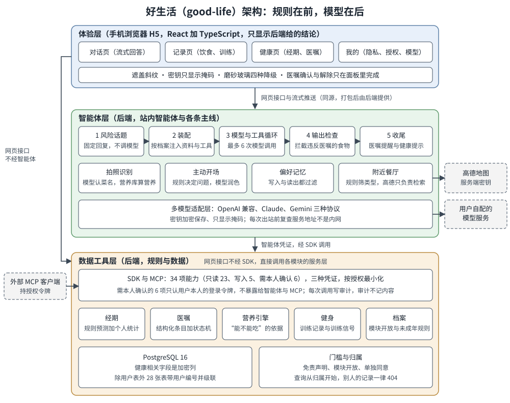

# 架构说明

本文说明好生活怎样分层、三条最重要的数据流怎样走、以及每个核心取舍背后的理由。取舍的完整记录（每条都写明放弃了什么）见《取舍记录》，创新点的场景与设计解释见《创新点说明》。

图里从上到下是三层：体验层、智能体层、数据工具层。实线箭头是一次请求的走向；虚线框是项目之外的东西（外部 MCP 客户端、用户自己配置的模型服务、高德地图）。图左侧从体验层直接绕到数据工具层的那条实线，表示网页接口不经智能体、也不经 SDK，直接调用各模块的服务层。读图时抓住一句话：凡是安全与事实的判断，都落在下面的数据工具层与智能体层里的规则上，模型只出现在智能体层的几个固定位置，并且每个位置前后都有规则把关。

## 三层结构

### 数据工具层

数据工具层是后端里“确定性”的部分：规则、数据、门槛与审计。它不依赖任何大模型也能完整工作，第一阶段就是只靠它加 SDK 与 MCP 完成演示的。

- 业务模块：经期（记录、统计、预测、阶段提示）、医嘱（原文与证据、规则提取、条目状态机、审计事件、当前约束）、营养（营养库、饮食记录、需求估算、约束引擎）、健身（动作库、训练记录、训练信号、运动限制冲突）、档案（模块开放、未成年规则）。营养引擎是全项目“这个能不能吃”的唯一依据，拍照识别、附近餐厅、智能体的依据段与输出检查都调用它。
- 门槛与归属：每个业务接口都要先过免责声明，经期与医嘱还要先有各自的单独同意；所有用户数据的查询都从“属于当前用户”开始写，别人的记录与不存在的记录返回同一个 404，不透露记录是否存在。
- SDK：把各模块的能力封装成“能力名、级别、输入模型、输出类型、处理函数”。级别有三种：只读、写入、需本人确认。一次调用的顺序固定：认证凭证、查能力、检查级别、免责门槛、模块准入、校验参数、执行、按声明类型序列化、写审计。能力不接受用户编号，身份只来自凭证。需本人确认的 6 项（医嘱的确认、修改、作废、继续生效、解除、撤销解除建议）只认用户本人的登录令牌，永远不出现在暴露给智能体与 MCP 的清单里。
- MCP：一个本地标准输入输出的小服务，只做协议转换，把 SDK 暴露的 28 项能力变成 28 个 MCP 工具，认证、级别、校验与审计全部交给 SDK。令牌来自环境变量，用户在“我的”页创建的授权令牌可以是只读或读写，可吊销，每次调用留审计。
- 网页接口：不经 SDK，直接调用各模块的服务层。SDK 的处理函数也只调用同一批服务层，所以网页、SDK、MCP、智能体四个入口共用同一套规则，不会出现“聊天里一个结论、页面上另一个结论”。
- 数据存储：PostgreSQL 16，29 张表（除用户表外的 28 张表都带用户编号并级联指向用户表）。健康相关的文字、数字与文件字节（档案健康状况、医嘱原文与条目、经期状态与每日记录、饮食与训练备注、对话内容、模型密钥、照片与证据文件等）用加密列保存；有一批列是明文，例如经期与每日记录的日期、医嘱的日期类别与状态、档案里的性别出生年份目标偏好忌口、饮食记录的食物名与营养数值，这些写在隐私说明里，不假装“全部加密”。除用户表外的 28 张表都带用户编号并级联指向用户表，删除用户行就是删除这个用户的全部数据。

### 智能体层

智能体层指所有会调用大模型的流程：站内对话、拍照识别里的看图、主动开场的措辞、附近餐厅的需求挑词。共同点是：模型只在固定位置出现，输入由规则装配，输出由规则检查，检查不过就退回固定内容。

- 对话循环：保存用户消息，判断风险话题，按档案装配，调用模型并执行工具，输出检查，收尾，保存。每轮最多 6 次模型调用，输出检查要求的那一次重写不计入。
- 装配：上下文全部经 SDK 用智能体凭证读取，所以每次读取都有审计；工具随档案变化（经期工具只在经期开放且用户已单独同意时提供，训练查询类工具只在最近 30 天有训练记录时提供，附近餐厅只在服务端配置了高德密钥时提供）；用户自己写的文字（偏好、忌口、医嘱内容、偏好记忆）放进带说明的资料块，压平换行并替换括号，不能冒充指令。
- 工具：28 项暴露的 SDK 能力加偏好记忆，一共有 6 个写入工具。工具调用只认本轮发给模型的声明，其余一律回“没有这个工具”。
- 输出检查：纯函数，不访问数据库也不调用模型，见下文第一条数据流。
- 多模型适配：OpenAI 兼容格式、Claude、Gemini 三种协议各一个自己写的适配器，换成中立的消息、工具调用与错误类型；密钥只存密文、界面只给掩码，保存时与每次出站前都复查服务地址不是内网。
- 其余流程：拍照识别（模型只认菜名，营养由营养库算）、附近餐厅（规则筛类型，高德只负责检索，建议只是按类别的一般性建议）、主动开场（规则按优先级决定问什么，模型改写不合格就用模板）、偏好记忆（写入时与读出时各过滤一次）。

### 体验层

体验层是手机浏览器里的单页应用，打包后由后端在根路径一并提供，同源，不开跨域。

- 只显示，不判断：结论、说明与错误码原样显示后端返回的内容；前端写死的只有标签映射、流程文案与后端固定文案的副本，副本集中在一个契约文件里，由后端测试逐字核对。
- 接口类型由后端接口描述生成并提交，接口一变，快照测试与前端类型检查会一起提醒。
- 隐私相关的界面做法：敏感区可一键遮盖（不透明斜纹，对读屏隐藏，切后台再回来自动遮盖）；密钥只显示后端给的掩码；医嘱的确认与解除只能在医嘱页的面板里二次确认，聊天里没有任何确认控件。
- 手机适配：磨砂玻璃只用在不随内容滚动的外壳上，有四种降级到实色的条件；触控目标不小于 44 像素；首屏预算（对话路由，压缩后脚本 150 KB、样式 22 KB、预加载字体 45 KiB）由构建检查守护。

## 数据流

### 一次对话

1. 用户在对话页发送一句话。前端发出请求，回答以流式方式推回：先推送若干片段，最后推送完成或出错。
2. 后端先过登录与免责声明，保存用户消息。
3. 风险话题判断：按自伤、严重症状、孕期异常、用药、极端节食的优先级用关键词规则判断，未成年用户再判断未成年减重。命中就直接回固定的安全回复（都含 120 急救或就医指引），不解析模型配置、不调用模型、不调用任何工具，用户原话也不会在以后的对话里回放给模型。
4. 装配：读档案、模块开放情况、生效的医嘱约束、经期阶段、当日摄入、今日训练，挑选工具，写系统指令。没有单独同意的模块在这一轮当作未开放。
5. 调用用户为“日常对话”选的模型。模型要查数据就发出工具调用，后端经 SDK 执行（写入类工具同样经 SDK，所以都有审计），把结果交回模型，直到模型给出最终回答或用满次数。
6. 输出检查：回答与用户消息里提到的食物（每轮最多 20 种）都请营养引擎按默认份量判断。回答里只要出现被医嘱阻断的食物，不论语气，一律算违反；检查先把全角、繁体、零宽字符、夹在汉字之间的空格与标点归一，再查子串，所以拆字、加符号、写繁体都绕不过。用户有饮食类医嘱而回答提到没能判断的食物，按不能吃处理。违反时让模型不带工具重写一次，仍然违反就换成固定的安全回答。
7. 收尾：去掉模型自己写的“依据”段，依据只来自引擎，原样放进单独的字段；程序在回答后面附医嘱提醒与“仅供参考”的健康提示；整轮的工具调用与结果执行完才一起保存。
8. 前端显示回答，依据默认折叠；本轮调用过写入工具的，按工具对应的数据域刷新相关页面。

失败时的表现：没有选对话模型是明确的提示与去设置的入口；模型服务出错时用户消息保留、可以重试；用满工具次数时给出固定的“请把问题说得更具体”。

### 一次拍照识别

1. 用户拍照或从相册选图上传。请求体上限在鉴权与解析之前就拦截，过大的请求直接 413。
2. 图片处理：按文件头判断格式（不信扩展名），转正方向，去掉全部元数据（包括位置），缩小并重新编码为 JPEG。发给模型与可能保存的只能是这一步的输出。
3. “看图识别”用途的模型只返回菜名、份量说法、估计克数与把握程度，最多 12 项；约定字段之外的内容全部忽略，包括模型写的说明文字，它不会出现在任何地方。调用模型期间不占数据库事务。
4. 匹配营养库：能匹配的按份量换算克数，再用营养库每 100 克的数值乘克数算出热量与营养，附数据出处与授权状态；匹配不上、把握低、克数越界或只有估计克数的项标为待确认，不给数字。
5. 保存草稿，原图默认不保留，用户上传时勾选保留才加密保存，随时可删。
6. 用户逐项修正（改菜名、改份量、从候选里选），后端重新换算。
7. 用户确认后才写入饮食记录，同时由营养引擎评价这一餐；没能核对的菜按不能吃处理。放弃或删除识别记录不影响已经写入的饮食记录。

### 一次医嘱确认

1. 用户录入医嘱原文（可附照片或 PDF 证据，加密保存）。提取由规则提取器完成，不是模型；它只产出“待确认”的候选条目，把握低或拿不准的会标出来，被忽略的句子与原因也列出来。
2. 待确认的条目不是约束。用户在医嘱页逐条核对，必要时修改内容。
3. 用户打开确认面板，先读到“确认后会发生什么”，再点明确的确认按钮。这是网页接口，用的是用户本人的登录令牌，审计来源记为用户。条目变为生效中，成为硬约束。
4. 生效后，营养引擎、输出检查、附近餐厅、运动冲突提示都按它判断。到了复核日、或临近预计结束日，条目转为待复核，仍然按原要求执行，直到用户处理。
5. 解除：用户在聊天里说“医生说我好了”，智能体只能提出解除建议，约束照常生效；用户在医嘱页的面板里勾选“不可撤销”的确认后才能解除。解除后条目移入历史，审计记录保留。
6. 每一步（创建、修改、状态变化）都写一条审计事件。聊天界面里没有确认与解除控件，由前端测试与端到端测试守护。

## 核心取舍与理由

下表只写结论与一句理由；每条取舍的“放弃了什么”和更多细节见《取舍记录》。

| 取舍 | 理由 |
|---|---|
| 规则在前、模型在后 | 安全与事实不能靠模型的自觉。规则可测试、可复现，模型只负责说得自然，规则不过就退回固定内容 |
| 医嘱是硬约束，其余是软约束 | 医嘱来自医生，目标、经期阶段与偏好来自个人倾向；软约束只能提示权衡，不能把医嘱禁止的结论放宽 |
| 营养引擎是唯一依据 | 拍照、餐厅、对话共用一个判断来源，结论才一致、依据才能追溯；引擎是纯函数，同样输入永远同样输出 |
| 需本人确认的动作不暴露给模型 | 注入最坏的后果是模型被带偏，所以让模型根本拿不到会改变约束的工具；代价是智能体不能替用户办完整件事 |
| SDK 与网页共用服务层 | 一套规则四个入口，行为不会分叉；代价是 SDK 的能力清单要和接口一起维护 |
| 自己写适配器与对话循环 | 适配层会直接接触用户密钥，依赖越少供应链风险越小；循环只有五个节点，自写更可控、更好测 |
| 单体后端，不拆微服务 | 单人项目，数据与规则强耦合，拆开只增加运维与一致性成本；用目录与依赖方向保持清晰 |
| 前端不做业务判断 | 规则只有一份，改规则不改界面；副本集中、由测试守护 |
| 模型相关的测试用脚本化的模拟模型 | 能稳定地证明“模型完全听从注入时硬边界仍成立”，也不依赖真实密钥与网络；真实模型的表现由用户用实测脚本补测 |
| 加密列加明文列，如实写明 | 日期、状态等明文列要参与排序与筛选；不假装全部加密，不做按用户加密 |
